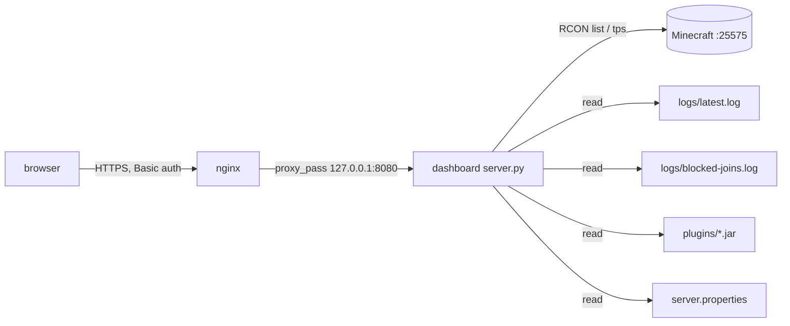

# Dashboard — architecture (proposal)

Read-only web page for the Minecraft server. This document is the design; it is
not implemented yet.

## Goal

One HTML page, served by the server itself, that shows at a glance:

- **Players** — how many are connected, and their names (Java and Bedrock).
- **Rejected joins** — name + IP of blocked (non-whitelisted) attempts.
- **Versions** — Paper/Minecraft, Java, and every plugin with its version.
- **Server** — MOTD, world, max players (`server.properties`).

Optional (see "Open questions"): TPS/MSPT + uptime.

## Non-goals

- No writes: no console, no restart button, no command box.
- No accounts, sessions, or database — one shared Basic-auth credential.
- No client-side JavaScript, no build step, no CDN.
- No new services to install (no Redis, no app server, no container).

## Constraints (from `TASKS.md` + recon)

- Listen on a **non-80 port**; expose on `0.0.0.0` **or** behind the existing
  nginx.
- Run as `steve` under **systemd**, same style as `autoplug.service`.
- Read-only; **never** expose the RCON password or the AutoPlug server key to
  the browser. Player names are shown, so the page needs auth.
- Server facts: Ubuntu 24.04 (aarch64), `python3` 3.12.3 present, no
  go/node/bun, nginx 1.24 **active** with a `*.example.com` wildcard cert, and
  wildcard DNS so any `*.example.com` subdomain resolves.

## Decisions

| area | choice | why | rejected |
|---|---|---|---|
| Language | **Python 3.12, standard library only** | Already installed; `http.server`, `socket` (RCON), `zipfile` (read `plugin.yml` from jars), `base64`, `html` cover everything | Go/Node — not installed, need a toolchain; Python + Flask — a venv and deps for no benefit |
| Framework | **none** — `ThreadingHTTPServer` + one `BaseHTTPRequestHandler` | One file, ~250 lines, no magic | Flask/FastAPI/FastCGI |
| CSS | **none** — one hand-written `<style>` block | A page with three tables doesn't need a library; no CDN means it works offline and leaks nothing | Tailwind/Bootstrap (build step or external CDN) |
| Frontend logic | **none** — `<meta http-equiv="refresh">` for auto-refresh | "Simplest": server renders everything; refresh is a page reload | JS `fetch`/WebSocket/SSE |
| Player source | **RCON `list`** on `127.0.0.1:25575` | Authoritative live count + names, already enabled (`enable-rcon=true`); no join/leave state to maintain across log rotation | parsing `latest.log` joins (fragile — a chat plugin rewrites `X joined the game` to `System chat: ...`) |
| Rejected source | **`logs/blocked-joins.log`** | Written by `scripts/alert-nonwhitelist.sh`; already tab-separated `ts/name/ip/iso` | re-parsing whitelist lines from the live log |
| Versions | **log head + `plugins/*.jar` `plugin.yml`** | No extra tooling; `zipfile` reads the manifest in-process | `unzip`/shelling out |
| Auth | **HTTP Basic in-app**, credentials in an env file | One place, works with or without nginx; constant-time compare | nginx-only auth (splits config), no auth (names exposed) |
| Rendering | **server-side string + `html.escape`** | No template engine needed | Jinja2 (dependency) |

## Data flow



The dashboard only ever issues read-only RCON commands (`list`, `tps`,
`mspt`). Everything else is reading files it already has access to.

## Panels → source

| panel | source | notes |
|---|---|---|
| Players online | RCON `list` | `There are N of a max of M players online: a, b` |
| Max players / MOTD / world | `server.properties` | `max-players`, `motd`, `level-name` |
| Rejected joins (last ~20) | `blocked-joins.log` | newest last; show as a table |
| Paper / Minecraft / Java | head of `logs/latest.log` | `Loading Paper … for Minecraft 26.2`, `Running Java 25 …` |
| Plugins + versions | `plugin.yml` inside `plugins/*.jar` | fallback to the jar filename |
| TPS / MSPT (optional) | RCON `tps` / `mspt` | hidden if the command is unavailable |

## HTTP surface

| method | path | response |
|---|---|---|
| `GET` | `/` | the HTML page (all panels) |
| `GET` | `/healthz` | `ok` — for systemd/nginx checks |
| any other | `*` | `405` / `404`, no body |

- Auth: `Authorization: Basic …`, required on every path except `/healthz`
  (optional). Missing/wrong → `401` with `WWW-Authenticate`.
- Connect timeout on RCON + per-collector `try/except`: one failing source
  degrades one panel, never the whole page.

## Runtime & deployment

```
dashboard/
  server.py            # the whole app
  ARCHITECTURE.md      # this file
systemd/mc-dashboard.service
```

- `mc-dashboard.service`: user `steve`, `Restart=always`,
  `EnvironmentFile=-/home/steve/minecraft/dashboard.env`,
  `ExecStart=/usr/bin/python3 /home/steve/minecraft/dashboard/server.py`,
  `After=network-online.target autoplug.service` (Wants, so RCON is up but a
  dead Minecraft doesn't block the page).
- Hardening: `NoNewPrivileges=yes`, `PrivateTmp=yes`, `ProtectSystem=full`,
  `ProtectKernelTunables=yes`, `ProtectControlGroups=yes`,
  `RestrictAddressFamilies=AF_INET AF_INET6`. **Not** `ProtectHome` (the app
  must read `~/minecraft`).
- Deployment = copy `dashboard/` + the unit, `daemon-reload`, `restart`. Same
  flow as the alerts service.

## Configuration & secrets

`~/minecraft/dashboard.env` (mode 600, git-ignored, same pattern as
`mc-alerts.env`):

```
DASH_USER=...
DASH_PASS=...
DASH_BIND=127.0.0.1
DASH_PORT=8080
MC_DIR=/home/steve/minecraft
REFRESH=15
```

The RCON password is read from `server.properties` at startup and used only
server-side.

## Failure modes

| failure | effect | mitigation |
|---|---|---|
| Minecraft down / RCON refused | players + TPS panels say "unavailable" | each collector isolated; short RCON timeout |
| `blocked-joins.log` missing | rejected panel empty | treat as empty list |
| a jar has no `plugin.yml` | that plugin shows filename | fallback |
| `latest.log` rotated mid-read | versions panel keeps last good value | errors are non-fatal |
| reload storm | extra RCON calls | cache collector results ~5 s |

## Open questions

1. **Exposure** — nginx + HTTPS on a subdomain (reuses the wildcard cert), a
   direct `0.0.0.0:8080` over plain HTTP, or localhost-only (SSH tunnel)?
2. **Optional panels** — include TPS/MSPT + uptime? world/MOTD? a
   `/state.json` for scripting? Or required panels only?
