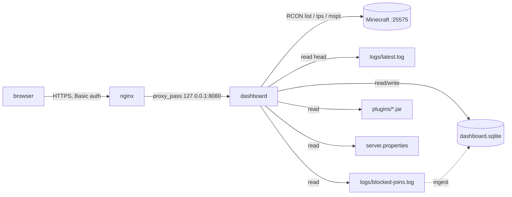

# Dashboard — architecture

Read-only web page for the Minecraft server, with a short history of players and
rejected joins. This is the agreed design; it was implemented on 2026-10-13
(see the README, "Dashboard").

## Goal

One HTML page, served by the server itself, that shows at a glance:

- **Players** — how many are connected, and their names (Java and Bedrock).
- **Rejected joins** — name + IP of blocked (non-whitelisted) attempts.
- **Versions** — Paper/Minecraft, Java, and every plugin with its version.
- **Server** — MOTD, world, max players, world size on disk.
- **Performance** — TPS/MSPT and uptime.
- **History** — players online over time, per-player play sessions, and
  rejected-join counts, from a local time-series store.

## Non-goals

- No writes to the game: no console, no restart button, no command box.
- No accounts, sessions, or external database service — one shared Basic-auth
  credential and a local SQLite file.
- No client-side JavaScript, no build step, no CDN. Charts are static SVG
  rendered by the server.

## Constraints (from `TASKS.md` + recon)

- Listen on a **non-80 port**; expose on `0.0.0.0` **or** behind the existing
  nginx.
- Run as `steve` under **systemd**, same style as `autoplug.service`.
- Read-only; **never** expose the RCON password or the AutoPlug server key to
  the browser. Player names are shown, so the page needs auth.
- Server facts: Ubuntu 24.04 (aarch64), `python3` 3.12.3, no go/node/bun,
  nginx 1.24 **active** with a `*.example.com` wildcard cert, wildcard DNS
  resolves for any `*.example.com` subdomain, and RCON is already enabled
  (`enable-rcon=true`, `rcon.port=25575`).

## Decisions

| area | choice | why | rejected |
|---|---|---|---|
| Language | **Python 3.12, standard library only** | Already installed; `http.server`, `socket` (RCON), `zipfile` (read `plugin.yml` from jars), `sqlite3`, `base64`, `html` cover everything | Go/Node — not installed, need a toolchain; Python + Flask — a venv and deps for no benefit |
| Framework | **none** — `ThreadingHTTPServer` + one `BaseHTTPRequestHandler` | No magic, no routing layer to learn | Flask/FastAPI |
| CSS | **Pico CSS v2, classless variant, vendored** (`dashboard/static/pico.classless.min.css`) | Semantic HTML needs **no classes**, so `render.py` emits plain `<table>`/`<h2>` and the server stays the only place with logic; one ~10 KB file served locally, so no CDN, works offline | hand-written style block; Water.css (plainer tables); Bootstrap (~227 KB, a class on every element); Tailwind (build step) |
| Layout | **`static/app.css`** (~2.5 KB) on top of Pico, multi-column flow | Pico scales the root font with the viewport (131.25% at ≥1536px) and caps content at 1450px, which reads oversized for a metrics page and wastes a wide screen. The override pins the type size, adds a full-width container and flows the cards into `columns: 5 26rem` — 2 columns on a laptop, 4 at 1920, 5 at 3440 | CSS grid (unequal card heights leave row gaps), masonry (not portable), a class-based framework (markup churn) |
| Frontend logic | **none** — `<meta http-equiv="refresh">` + server-rendered inline SVG | "Simplest": the server renders everything, including the charts. The timespan switch is a plain link (`?span=7d`), which the meta refresh keeps, and values are read on hover through SVG `<title>` — so interactivity needs no JavaScript either | JS `fetch`/Chart.js/uPlot/WebSocket |
| Chart window | **`?span=24h\|7d\|30d\|90d`**, bucket sizes 30 min→1 day | One table (`store.SPANS`) feeds both the query and the panel title, so they cannot drift; every span stays at 48-168 points | client-side zoom/pan (needs JS); a fixed window |
| Storage | **SQLite** (`sqlite3`, stdlib) | Embedded, one file, zero services, real SQL for time buckets; enough for a time series of this size | see "Storage" below |
| Player source (live) | **RCON `list`** on `127.0.0.1:25575` | Authoritative live count + names; no join/leave state to maintain | parsing `latest.log` joins (fragile — a chat plugin rewrites `X joined the game` to `System chat: ...`) |
| Player history | **RCON `list` sampled every 30 s, diffed** | Robust: exact names from RCON, transitions derived from consecutive samples (±30 s) | log-derived sessions (same fragility), player-event plugins |
| Rejected source | **`logs/blocked-joins.log`**, ingested into SQLite | Already written by `scripts/alert-nonwhitelist.sh`, append-only, tab-separated `ts/name/ip/iso`; ingest by byte offset is idempotent | re-parsing whitelist lines from the live log |
| Versions | **log head + `plugins/*.jar` `plugin.yml`** | No extra tooling; `zipfile` reads the manifest in-process | `unzip`/shelling out |
| Auth | **Sign-in form (`/login`) + HMAC-signed session cookie** | A real form with labelled `username`/`current-password` fields is what password managers save; Basic auth is not saved. Cookie: `HttpOnly`, `SameSite=Lax`, `Secure` behind TLS, 30-day expiry, key derived from the password (so a password change logs everyone out) | HTTP Basic (not saved by password managers), nginx-only auth, no auth |
| Rendering | **server-side string + `html.escape`** | No template engine needed | Jinja2 |

## Storage (the "TSDB" question)

The requirement is a *time series* of two things: players online, and rejected
joins. The lightest thing that does this well is **SQLite** via the standard
library:

- It is a single file (`~/minecraft/dashboard.sqlite`), no daemon, no port, no
  config, and it survives restarts.
- Time-bucketed aggregation is a `GROUP BY strftime('%Y-%m-%d %H:00', ts)`
  query; no TSDB needed at this volume (dozens of rows/day).
- It is trivially backed up (it is inside `~/minecraft`) and can be deleted to
  start over.

Alternatives and why not, for this scale:

| option | verdict |
|---|---|
| **Prometheus + Grafana** | The "real" TSDB + dashboard stack — but two new services, a scrape endpoint, retention config, and a second UI, to plot two lines for one family. Over-kill. |
| **MariaDB** (already running on `:3306`) | Viable and already installed, but adds credentials, a schema in someone else's database, and a runtime dependency. No gain over SQLite here. |
| **Redis** (already running on `:6379`) | Great for counters, awkward for time-bucketed range queries and retention. |
| **JSONL append + read** | Simplest to write, but every query is a full scan and retention/pruning is manual. SQLite costs nothing more. |

### Schema (sketch)

```sql
-- one row per sampler tick (drives the "players online" and TPS charts).
-- up = 0 marks a tick where RCON did not answer: `players` is meaningless (0)
-- then and readers filter it out, so a row is *evidence* of an outage rather
-- than a gap. `up` was added on 2026-10-16; Store._migrate() ALTERs it in with
-- DEFAULT 1, which is correct for the older rows (they were only written while
-- the server answered).
CREATE TABLE samples (
  ts INTEGER PRIMARY KEY, players INTEGER, tps REAL, mspt REAL,
  up INTEGER NOT NULL DEFAULT 1
);

-- join/leave transitions derived from consecutive samples
CREATE TABLE sessions (
  ts INTEGER, player TEXT, event TEXT CHECK (event IN ('join','leave'))
);
CREATE INDEX sessions_player_ts ON sessions(player, ts);

-- ingested from blocked-joins.log (UNIQUE makes ingest idempotent)
CREATE TABLE rejects (
  ts TEXT, name TEXT, ip TEXT, ts_iso TEXT,
  UNIQUE (ts, name, ip)
);
```

- **Sampler:** a daemon thread inside the app calls RCON `list` every 30 s,
  writes a `samples` row, and diffs the name set against the previous tick to
  write `sessions` rows. The first tick after a restart is a baseline: it
  records a sample but emits **no** join/leave events (avoids a fake "everyone
  left" on reboot).
- **Reject ingest:** the same thread tails `blocked-joins.log` by byte offset
  and inserts new rows (`INSERT OR IGNORE`).
- **Retention:** prune rows older than `RETAIN_DAYS` (default 90) once a day.

The page reads only from SQLite for history (fast, no re-parsing); the live
panels still read RCON/files as before.

## Data flow



Read-only RCON commands only (`list`, `tps`, `mspt`). SQLite is the only thing
the app ever writes.

## Panels → source

| panel | source | notes |
|---|---|---|
| Players online | RCON `list` | `There are N of a max of M players online: a, b` |
| Max players / MOTD / world | `server.properties` | `max-players`, `motd`, `level-name` |
| World size | `du` of `level-name` dir | computed in-process (walk + sum) |
| TPS / MSPT + uptime | RCON `tps` / `mspt`, `/proc` or `systemd` | hidden if the commands are unavailable |
| Rejected joins (recent) | SQLite `rejects` | newest first, with name + IP |
| Rejected joins (history) | SQLite `rejects` | count per bucket over the span, top names/IPs |
| Server up/down (banner) | RCON + `systemctl is-active` + `/proc` | the first card, full width |
| Availability % | SQLite `samples.up` | share of sampled ticks that answered |
| Players online (chart) | SQLite `samples` | inline SVG line, peak per bucket, outage bands |
| TPS (chart) | SQLite `samples.tps` | inline SVG line, average per bucket |
| Play sessions | SQLite `sessions` | recent joins/leaves, and per-player playtime |
| Paper / Minecraft / Java | head of `logs/latest.log` | `Loading Paper … for Minecraft 26.2`, `Running Java 25 …` |
| Plugins + versions | `plugin.yml` inside `plugins/*.jar` | fallback to the jar filename |

## HTTP surface

| method | path | response |
|---|---|---|
| `GET` | `/` | the HTML page (all panels); `?span=24h\|7d\|30d\|90d` picks the chart window (an unknown value falls back to 24h) |
| `GET` | `/state.json` | same data as JSON, for scripting (same `?span=`) |
| `GET` | `/static/pico.classless.min.css` | the vendored stylesheet |
| `GET` | `/healthz` | `ok` — for systemd/nginx checks |
| `GET` | `/login` | the sign-in form (redirects to `/` when already signed in) |
| `POST` | `/login` | checks credentials → `302` + session cookie, or `401` with the form and an error |
| `POST` | `/logout` | clears the cookie → `302 /login` |
| any other | `*` | `405` / `404`, no body |

- Auth: the `mc_session` cookie on every path except `/healthz`, `/static/`
  (the stylesheet is not sensitive) and `/login`. Missing or invalid → `302` to
  `/login?next=<path>`.
- POSTs are guarded by `SameSite=Lax` plus an `Origin`/`Host` check: a
  verifiable cross-site origin is rejected with `403`, while an opaque `null`
  origin is accepted (Chromium sends it when the referrer policy hides the
  origin — hence `Referrer-Policy: same-origin`, not `no-referrer`).
- Failed logins are throttled per client IP (10 per 15 min → `429`).
- Per-collector `try/except` + RCON timeout: one failing source degrades one
  panel, never the whole page.

## Runtime & deployment

```
dashboard/
  server.py       # entrypoint: HTTP server, auth, routes, sampler thread
  collect.py      # RCON + file readers (live data)
  store.py        # SQLite schema, ingest, queries (history)
  render.py       # HTML + inline SVG
  static/
    pico.classless.min.css   # vendored Pico CSS v2 (no CDN)
    app.css                  # dense layout + multi-column flow
  ARCHITECTURE.md
systemd/mc-dashboard.service
```

- `mc-dashboard.service`: user `steve`, `Restart=always`,
  `EnvironmentFile=-/home/steve/minecraft/dashboard.env`,
  `ExecStart=/usr/bin/python3 /home/steve/minecraft/dashboard/server.py`,
  `After=network-online.target autoplug.service` (Wants, so a dead Minecraft
  doesn't block the page).
- Hardening: `NoNewPrivileges=yes`, `PrivateTmp=yes`, `ProtectSystem=full`,
  `ProtectKernelTunables=yes`, `ProtectControlGroups=yes`,
  `RestrictAddressFamilies=AF_INET AF_INET6 AF_UNIX` (the last one for
  `systemctl show`). **Not** `ProtectHome` (the app must read/write
  `~/minecraft`).
- Deployment = copy `dashboard/` + the unit, `daemon-reload`, `restart`; plus an
  nginx `server` block for `mc.example.com` with `proxy_pass
  http://127.0.0.1:8080` and the existing `*.example.com` certificate.

## Configuration & secrets

`~/minecraft/dashboard.env` (mode 600, git-ignored, same pattern as
`mc-alerts.env`):

```
DASH_USER=...
DASH_PASS=...
DASH_BIND=127.0.0.1
DASH_PORT=8080
MC_DIR=/home/steve/minecraft
REFRESH=15
SAMPLE_SECONDS=30
RETAIN_DAYS=90
```

The RCON password is read from `server.properties` at startup and used only
server-side.

## Failure modes

| failure | effect | mitigation |
|---|---|---|
| Minecraft down / RCON refused | the banner turns red, players/TPS live panels degrade | each collector is isolated (one failing source never breaks the page); the sampler keeps ticking and records `up = 0`, so the outage becomes a band in the charts and lowers the availability figure. `starting` vs `down` is told apart with `systemctl is-active` + the Paper pid + uptime. |
| `systemctl`/`/proc` unavailable | status reads `down` while RCON is fine | RCON is checked first: a working RCON always wins, so a broken unit-query cannot make a live server look dead |
| app restart | potential fake mass-leave | first tick is a baseline, emits no events |
| `blocked-joins.log` missing | rejects panel empty | treat as empty; ingest resumes when it appears |
| SQLite locked/corrupt | history panels fail | single writer (sampler) + short timeout; file is disposable |
| a jar has no `plugin.yml` | that plugin shows filename | fallback |
| `latest.log` rotated mid-read | versions keep last good value | non-fatal |
| reload storm | extra RCON calls | cache collector results ~5 s |

## Decisions taken (2026-10-13)

- Runtime: Python 3 standard library. CSS: Pico CSS v2, classless, vendored.
- Storage: SQLite embedded at `~/minecraft/dashboard.sqlite`.
- Cadence and retention: 30 s samples, 90 days.
- Exposure: nginx + HTTPS at `mc.example.com` (vhost in `nginx/`); the app
  binds `127.0.0.1:8080` only.
- Extras included: TPS/MSPT + uptime, world size, `/state.json`, and the player
  and rejected-join history.

## Decisions taken (2026-10-16): outages, charts, timespans

- **Uptime is data, not a live probe.** The sampler now writes a row on every
  tick, `up = 0` when RCON does not answer, instead of skipping the tick. That
  turns "the dashboard was not running" (no row) and "the server was down" (a
  row with `up = 0`) into two distinguishable states, which is what the outage
  bands and the availability percentage are drawn from.
- **The banner is the answer to "is it up?".** One full-width card, first on
  the page, with the unit state, the Paper pid, the uptime, the player count
  and how much of the selected window was up. It is toned through
  `data-status` (up/warn/down) rather than classes; `--mc-down` doubles as the
  chart band colour.
- **One chart engine, a real time axis.** `time_chart()` replaced the old
  bar-per-index renderer: points are placed by timestamp, so a missing bucket is
  a gap and never a fake zero, and sparse data (7 rejected joins ever) cannot
  flatten the axis. It draws y gridlines on 1/2/5×10ⁿ steps, four x labels
  formatted for the window, an area+line or bars, outage bands behind the
  series, and `<title>` tooltips so hovering works without JavaScript.
- **Spans are links, not client state.** `?span=` is re-queried server-side and
  survives the 15 s meta refresh; `/state.json?span=` gives scripts the same
  window. History is cached ~20 s per span, so a 90-day query does not run on
  every page load.
- **`playtime` follows the span** so "Most played — last 7 days" is honest when
  the window is 24 h or 90 d.
- **Not chosen:** vendoring a JS charting library (uPlot/Chart.js) for zoom and
  pan. It would be ~50 KB and a second rendering path for a page that must work
  with no build step; the server-rendered SVG covers what the data supports at
  this cadence.
